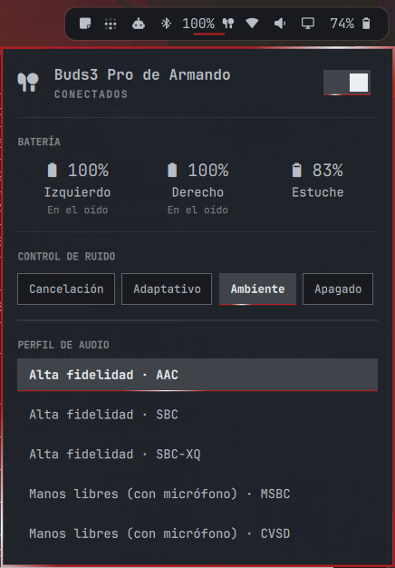

# Galaxy Buds

Samsung Galaxy Buds on the [Omarchy](https://omarchy.org/) bar: battery for each bud and the case, noise control, connect/disconnect, and the Bluetooth audio profile, all from one icon.



- **Battery for left, right and case.** BlueZ only reports one number for the whole headset. This plugin reads the per-bud and case levels the buds send over Samsung's own Bluetooth serial protocol, the same one the Galaxy Wearable app uses. Each bud also shows where it is: in ear, out of ear, or in the case.
- **Noise control:** noise cancelling, adaptive, ambient sound, or off.
- **Connect / disconnect** with the switch in the panel or a right click on the bar icon.
- **Audio profile:** switch between high fidelity playback (AAC, SBC, SBC-XQ) and hands-free with microphone (mSBC, CVSD), as offered by PipeWire.
- The bar icon can show the lowest bud battery next to it.
- English and Spanish UI, picked from the system locale.

## Supported models

Tested on Galaxy Buds3 Pro. The same protocol is used by Galaxy Buds+ and later (Buds Live, Buds Pro, Buds2, Buds2 Pro, Buds FE, Buds3), so they should work. Each model only accepts the noise control modes it has; adaptive, for example, is not on every model. The original 2019 Galaxy Buds use an older message format and are not supported.

Not affiliated with or endorsed by Samsung.

## Requirements

- Omarchy (Quattro)
- `python3`, `bluetoothctl` (bluez-utils) and `pactl` (libpulse), all present on a default Omarchy install
- Buds paired with the computer (use Omarchy's Bluetooth panel)

## Installation

```sh
omarchy plugin add https://github.com/afrancoguevara/omarchy-galaxy-buds.git --enable
```

The widget lands in the right section of the bar. Move it with `omarchy bar move afrancoguevara.galaxy-buds --section <left|center|right>`.

## Usage

| Action | Result |
|---|---|
| Left click the icon | Open or close the panel |
| Right click the icon | Connect or disconnect the buds |
| Hover the icon | Left, right and case battery |
| `Esc` | Close the panel |

The icon is dimmed while the buds are disconnected.

## Configuration

Add keys to the widget's entry in `bar.layout` in `~/.config/omarchy/shell.json`. All are optional.

```json
{ "id": "afrancoguevara.galaxy-buds", "showPercentage": true, "language": "en" }
```

| Key | Default | Description |
|---|---|---|
| `address` | auto-detect | Bluetooth address of the buds, e.g. `AA:BB:CC:DD:EE:FF`. By default the first paired Samsung headset is used. |
| `showPercentage` | `false` | Show the lowest bud battery next to the bar icon. |
| `language` | `auto` | `auto` follows the system locale; `en` or `es` forces a language. |

## How it works

`buds-status.py` runs in the background while the shell is up. When the buds are connected it opens an RFCOMM link to their Samsung serial port and decodes the status messages they send (battery, placement, noise control mode). It also reads the audio card from `pactl` and the connection state from `bluetoothctl`. It prints one JSON line to the panel whenever something changes, and takes noise control commands from the panel on stdin. It exits when the shell closes its stdin.

The RFCOMM channel is found by trying channels 1–30 the first time and cached in `~/.cache/omarchy-galaxy-buds/`.

- Connect / disconnect runs Omarchy's own `omarchy-bluetooth-device`.
- Profile changes run `pactl set-card-profile`.
- No network access, no sudo, and nothing is written outside that cache directory.

Only one app can hold the buds' serial link at a time, so the panel shows no battery details while another client (for example GalaxyBudsClient) is connected to them.

## Removal

```sh
omarchy plugin remove afrancoguevara.galaxy-buds
rm -rf ~/.cache/omarchy-galaxy-buds
```

## Credits

The message format comes from [GalaxyBudsClient](https://github.com/timschneeb/GalaxyBudsClient) by timschneeb, which documented the protocol. No code was copied from it.

## License

MIT. See [LICENSE](LICENSE).
